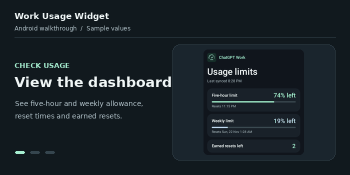

# Work Usage Widget

**See your ChatGPT Work and Codex limits on your Android home screen.** Check your remaining allowance, reset times and earned resets in a glance.

[**Download APK v1.2**](downloads/ChatGPT_Work_Usage_v1_2.apk?raw=true) · [Setup guide](docs/guide.md#quick-start) · [Release notes](docs/release-notes-v1.2.md) · [SHA-256 checksum](downloads/SHA256SUMS)

Android 8.0+ · Unofficial

*The walkthrough and screenshots use sample values.*

## Features

- **Usage at a glance.** See the five-hour and weekly allowances, reset times and earned resets.
- **Live sync or manual entry.** Connect with a device code or enter a snapshot from your dashboard.
- **Home-screen access.** Pin the widget and tap refresh for a new check when connected.

## Quick start

1. Install the APK and open **Work Usage**.
2. Tap **Connect with a device code** for live sync or **Enter dashboard values** to enter a snapshot.
3. Tap **Add to home screen**, then confirm in your launcher.

| App dashboard | Home-screen widget |
| :---: | :---: |
|  |  |

[Build from source](docs/guide.md#build-from-source) · [Privacy](PRIVACY.md)

This is an independent project. OpenAI does not sponsor or endorse it.
