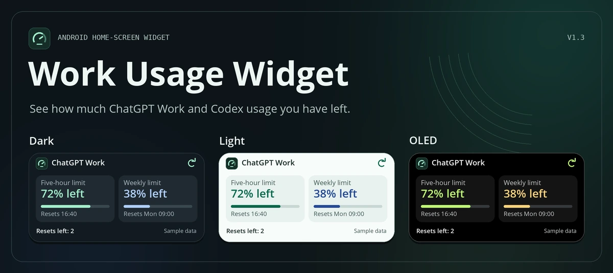

# Work Usage Widget

See your five-hour and weekly ChatGPT Work and Codex allowances, reset times, and earned resets on your Android home screen.

**[Download v1.3 APK](downloads/ChatGPT_Work_Usage_v1_3.apk?raw=true)** · Android 8.0+ · [SHA-256](downloads/SHA256SUMS)

## Get started

1. **Install.** Open the APK on Android. If you have v1.2, install v1.3 over it to keep your saved data and pinned widget.
2. **Add your usage.** Choose **Connect with a device code** for live sync or **Enter dashboard values** for manual entry.
3. **Pin and style it.** Tap **Add to home screen**. Open **Widget style** to preview Dark, Light, or OLED and apply it to your pinned widgets.

Tap the widget’s refresh icon to request a new check when connected. The footer shows when usage was last synced or entered.

[Full setup guide](docs/guide.md) · [What’s new in v1.3](docs/release-notes-v1.3.md) · [Build from source](docs/guide.md#build-from-source) · [Privacy](PRIVACY.md)

An independent Android app. Live sync uses Codex sign-in and depends on ChatGPT’s usage endpoints.
