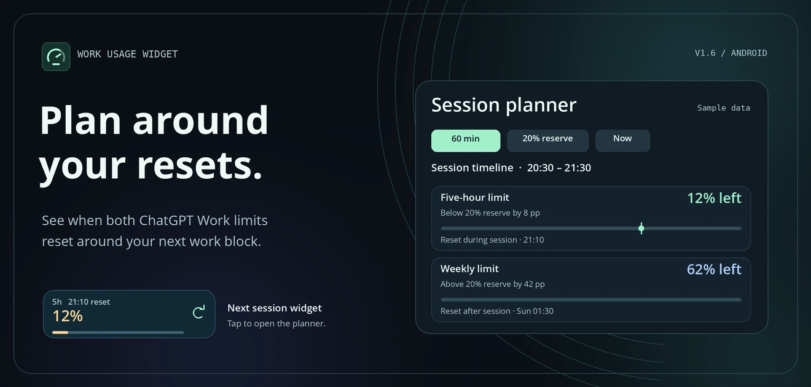
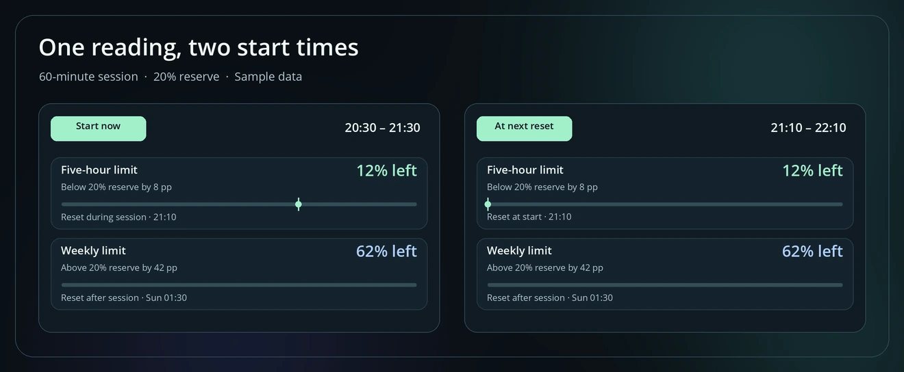

# Work Usage Widget

  <strong><a href="downloads/ChatGPT_Work_Usage_v1_6_2.apk?raw=true">Download v1.6.2 for Android</a></strong>

  Android 8.0+ · <a href="#get-started">Quick start</a> · <a href="docs/release-notes-v1.6.2.md">Release notes</a> · <a href="downloads/SHA256SUMS">SHA-256</a>

Check your ChatGPT Work and Codex allowances on Android. **Session planner** puts your five-hour and weekly resets on one timeline so you can see where they land in your next work block.

## Plan around a reset

1. Open **Plan a session** and choose a 30-, 60-, 90-, or 120-minute block.
2. Switch between **Now** and **At next reset** to see how the reported reset times line up with your block.
3. Pick a 10%, 20%, or 30% reserve. Each track shows how far its latest reported allowance is above or below that reserve.

The percentages stay tied to the latest reading. For reset timing, the planner uses a successful live sync from the last 30 minutes. The preview above uses sample data. [Details and examples](docs/guide.md#plan-a-session)

## On your home screen

| Widget | Size | What it shows |
| --- | --- | --- |
| **Next session** | 2 × 1 | The lower reported allowance, a reserve cue, and its reset time when it falls in your chosen block. Tap to open Session planner. |
| **Full** | 4 × 2 | Both allowances, reset times, earned resets, and the last update. |
| **Five-hour** | 2 × 1 | Five-hour allowance and progress bar. |
| **Weekly** | 2 × 1 | Weekly allowance and progress bar. |

Choose **Dark**, **Light**, **OLED**, **Ocean**, or **Sunset** in **Widget style**. The app also includes on-device seven-day history, optional low-usage alerts, and dashboard reset countdowns. [History and alerts](docs/guide.md#history-and-alerts)

## Get started

1. **Install** the signed APK. Install over your current copy to keep your existing setup.
2. **Add usage** by connecting through a device code or entering values from your dashboard.
3. **Pin a widget** through **Add to home screen**. Choose **Next session** for the planner shortcut.

[Setup guide](docs/guide.md) · [Troubleshooting](docs/guide.md#troubleshooting) · [Build from source](docs/guide.md#build-from-source) · [Privacy](PRIVACY.md)

Work Usage Widget is an independent Android app. Live sync uses Codex sign-in and depends on ChatGPT’s usage endpoints.
