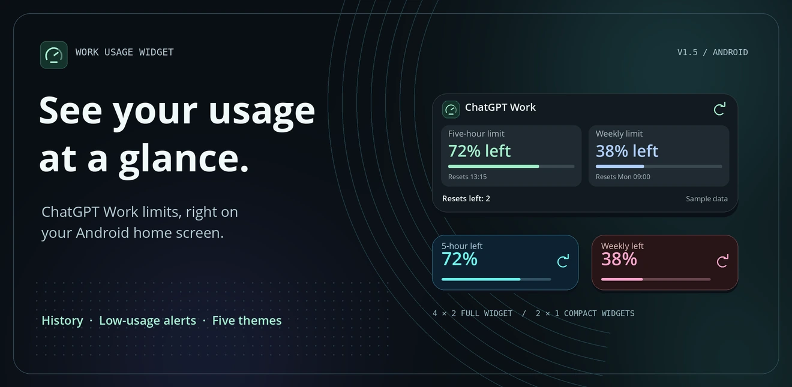
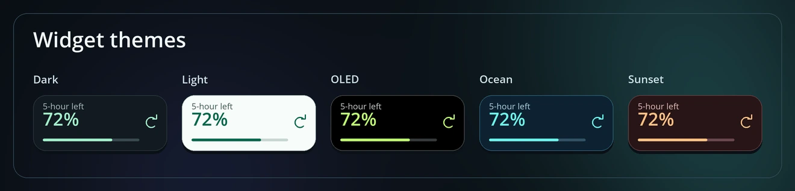
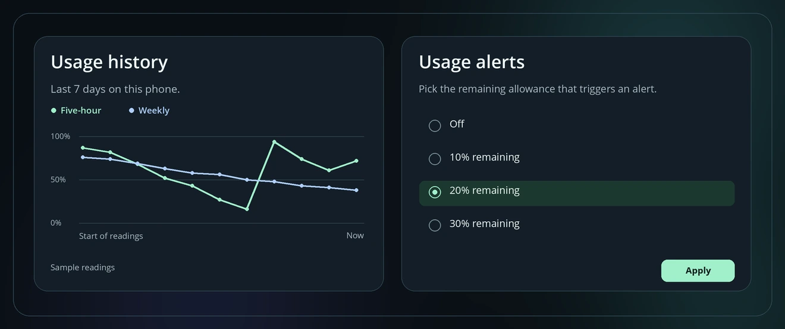

# Work Usage Widget

  

  Android 8.0+ · <a href="#get-started">Quick start</a> · <a href="docs/release-notes-v1.5.md">Release notes</a> · <a href="downloads/SHA256SUMS">SHA-256</a>

See your remaining ChatGPT Work and Codex allowance on your home screen. Open the app for reset countdowns, a seven-day history chart, and optional low-usage alerts.

## Choose your widget

| Layout | Home-screen size | What it shows |
| --- | --- | --- |
| **Full** | 4 × 2 | Both allowances, reset times, earned resets, and last update |
| **Five-hour** | 2 × 1 | Five-hour allowance and progress bar |
| **Weekly** | 2 × 1 | Weekly allowance and progress bar |

Pin any combination. **Widget style** previews each layout in every theme and applies your choice to all pinned widgets.

## Track your usage

- **History** charts the readings saved on this phone over the last seven days. It works with live sync and manual entries.
- **Usage alerts** can notify you when a successful sync finds either limit at or below 10%, 20%, or 30% remaining. Alerts are off by default.
- **Reset countdowns** show how long each limit has left next to the local reset time on the dashboard.

Previews use sample data. [How history and alerts work](docs/guide.md#history-and-alerts)

## Get started

1. **Install** the APK on Android. Install updates over your existing copy to keep your setup.
2. **Add your usage.** Connect with a device code for live sync, or enter values from the ChatGPT usage dashboard.
3. **Pin your widget.** Open **Add to home screen**, then choose **Full**, **Five-hour**, or **Weekly**.

[Setup guide](docs/guide.md) · [Troubleshooting](docs/guide.md#troubleshooting) · [Build from source](docs/guide.md#build-from-source) · [Privacy](PRIVACY.md)

Work Usage Widget is an independent Android app. Live sync uses Codex sign-in and depends on ChatGPT’s usage endpoints.
