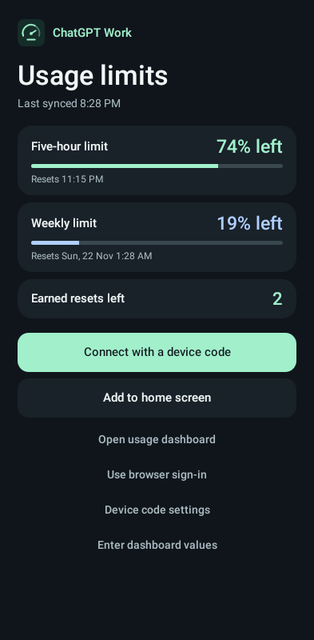
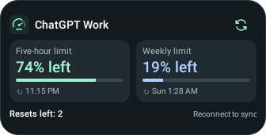

# Work Usage Widget

**See your ChatGPT Work and Codex allowance on your Android home screen.** Check your five-hour and weekly limits, when they reset, and how many earned resets you have left.

[**Download v1.2 APK**](downloads/ChatGPT_Work_Usage_v1_2.apk?raw=true) · [Release notes](docs/release-notes-v1.2.md) · [SHA-256 checksum](downloads/SHA256SUMS)

Unofficial Android companion · Android 8.0+ · [Setup](docs/guide.md#quick-start) · [Build from source](docs/guide.md#build-from-source) · [Privacy](PRIVACY.md)

| App dashboard | Home-screen widget |
| :---: | :---: |
|  |  |

*Both previews use sample values.*

## Quick start

1. Download and install the v1.2 APK, then open **Work Usage**.
2. Choose **Connect with a device code** for live sync or **Enter dashboard values** for manual entry.
3. Tap **Add to home screen** and confirm. Tap the widget’s refresh icon to check for updated values.

This project is independent. ChatGPT and Codex identify the supported services. OpenAI does not sponsor or endorse the project.
