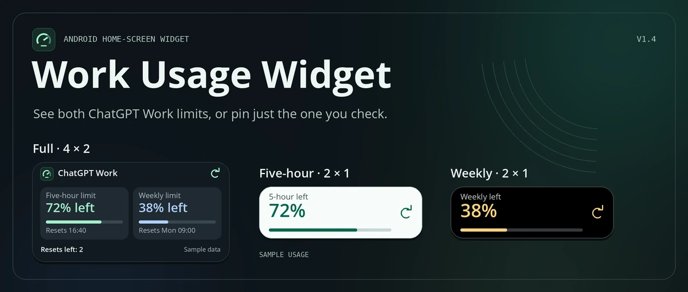

# Work Usage Widget

See how much ChatGPT Work and Codex usage you have left on your Android home screen. Pin the full dashboard or a compact widget for just the five-hour or weekly limit.

**[Download v1.4 APK](downloads/ChatGPT_Work_Usage_v1_4.apk?raw=true)** · Android 8.0+ · [SHA-256](downloads/SHA256SUMS)

## Get started

1. **Install.** Open the APK on Android. Update over your existing installation to keep your saved data and pinned widgets.
2. **Add your usage.** Choose **Connect with a device code** for live sync or **Enter dashboard values** for manual entry.
3. **Pick a widget.** Tap **Add to home screen** and choose **Full**, **Five-hour**, or **Weekly**. Open **Widget style** to preview Dark, Light, or OLED.

The **full widget** shows both allowances, reset times, earned resets, and the last update. Each **compact widget** shows one remaining allowance and a progress bar. You can pin multiple widgets. Tap their refresh icon to request an update when connected.

[Full setup guide](docs/guide.md) · [What’s new in v1.4](docs/release-notes-v1.4.md) · [Build from source](docs/guide.md#build-from-source) · [Privacy](PRIVACY.md)

An independent Android app. Live sync uses Codex sign-in and depends on ChatGPT’s usage endpoints.
